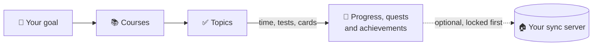

<h1 align="center">
  <br>
  <a href="https://github.com/sudharamachandranrajeev/vidya-learning-manager"></a>
  <br>
  Vidya
  <br>
</h1>

<h4 align="center">Plan what you want to learn, study a little every day, remember it, and show what you can do.</h4>

<p align="center">
  <a href="https://github.com/sudharamachandranrajeev/vidya-learning-manager/releases"></a>
  
  
  <a href="https://github.com/sudharamachandranrajeev/brahma-life-suite"></a>
</p>

<p align="center">
  <a href="#-what-it-does">What it does</a> •
  <a href="#-get-started">Get started</a> •
  <a href="#-how-it-works">How it works</a> •
  <a href="#-faq-and-troubleshooting">FAQ</a> •
  <a href="#%EF%B8%8F-for-developers">For developers</a>
</p>

<p align="center">
  
</p>

Vidya is a calm study companion for self-learners: a new career, a certification, a degree or a
pile of books. It turns a big goal into small steps, keeps a gentle daily habit, and shows real
progress. Status: **early test releases**. It needs no internet and no account.

## ✨ What it does

- 🗺️ **A plan for any goal** – a goal holds courses, and each course holds topics. Start from a
  template (software engineer, data analyst, cloud and DevOps) or write your own.
- 🤖 **Plans drafted by AI** – describe your goal or exam and let the AI you set up for
  **Ask AI** write the plan, or copy Vidya's prompt into any AI chat and paste the reply back.
  Courses with due dates, topics, study notes, skills and flashcards arrive in one go.
- ▶️ **Next up** – Home and each course show the one thing to study next, with one tap to start
  it (a video picks up where you stopped, "Resume at 12:30").
- 📖 **Topic pages** – each topic holds its videos, articles, books, practice tasks and your own
  notes. Take its quiz: missed questions become flashcards by themselves. A practice task needs
  an evidence link (or a note) to be done, and goes into your portfolio in one tap.
- 🎤 **Interview training** – practise each interview drill out loud against a timer, then rate
  yourself on four checks (situation, own actions, result, link to the criterion). Keep a story
  bank shown as STAR or CAR, answer scenario questions with a check / scope / escalate / hand
  over frame, review weak criteria first before the interview, and log how a real interview went.
- ✅ **Job readiness** – line up each criterion of the job (from Udyoga, or typed in from the
  person specification) against the evidence you built: topics, quiz scores, tasks, drills,
  stories, portfolio and skills. Each row is covered, weak or missing, shown as counts ("9 of 12
  essential covered, 2 weak, interview in 6 days") with one next step for the weakest row.
- 🔎 **Find free resources** – search Microsoft Learn, MIT Learn and Open Library at once for
  a topic or a role (OpenLearn opens in your browser). Free results come first, each with its length, level, a free /
  audit / paid badge and its licence; one tap adds it to a topic. Paste any other link (Coursera,
  YouTube, NHS e-LfH…) and Vidya reads its title for you.
- ⏱️ **Focus timer and study log** – run a quiet 15 to 60 minute timer, or log time by hand, on a
  course or a topic. Set a weekly time target if you like: Home shows how far you are since
  Monday, and a quiet week costs nothing. Record test scores as you go.
- 🃏 **Flashcards that stick** – cards come back just before you would forget them (spaced
  repetition). See what is due today and this week.
- 📈 **Skills and gaps** – rate each skill 0 to 5 and set a target. The gap is your to-do list.
- 🏆 **A portfolio** – projects, certificates, talks and degrees, each linked to the skills it
  proves. Copy it all as text for a CV.
- 📝 **Notes** – a searchable knowledge base with tags. Notes a plan made sit behind **From plans**
  so your own come first.
- 📤 **Your history, yours** – export everything you studied as Markdown or JSON from Settings.
- 📊 **Progress you did not type in** – study time, streaks, scores, retention and a weekly chart,
  all worked out from what you record.
- 🌱 **Quietly game-like** – three small quests a day, levels from Seed to Sage and 34
  achievements. No noise, no nagging.
- 🔒 **Private by design** – data is encrypted on the device. Sync is optional, and one account
  works in every Brahma app.

<details>
<summary>How experience and levels work</summary>

Experience comes from topics, study time (capped per day), tests, courses, programs (goals),
skill levels, portfolio items, notes, cards and reviews (capped per day) and achievements. Level
*n* starts at 50·n·(n−1) experience. Achievements unlock once and stay. Flashcards use a
day-by-day SM-2 schedule: **Again** brings a card back today; **Good** and **Easy** push it
further out each time.
</details>

## 📸 Screenshots

<table>
  <tr>
    <td align="center"><br><sub>Home</sub></td>
    <td align="center"><br><sub>Review</sub></td>
    <td align="center"><br><sub>Progress</sub></td>
  </tr>
  <tr>
    <td align="center"><br><sub>Achievements</sub></td>
    <td align="center"><br><sub>Home (dark)</sub></td>
    <td align="center"><br><sub>Home on a desktop</sub></td>
  </tr>
</table>

<p align="center">
  <br>
  <sub>Progress on a desktop window</sub>
</p>

<sub>All screenshots show a made-up learner, rendered from the app's code.</sub>

## 🚀 Get started

### Step 1 – Download

Open the [releases page](https://github.com/sudharamachandranrajeev/vidya-learning-manager/releases) and, under
the newest release, pick the file for your device:

| Your device | File to download | Works on |
| --- | --- | --- |
| 🐧 Linux computer | `Vidya-<version>-linux-x64.tar.gz` | Ubuntu 24.04, Fedora, Arch and similar (64-bit x86) |
| 🪟 Windows computer | `Vidya-<version>-windows-x64-setup.exe` | Windows 10 and 11 |
| 🤖 Android phone | `Vidya-<version>-android.apk` | Android 7 and newer |

Each release also has `SHA256SUMS.txt`, a list of fingerprints to check the files are genuine.

### Step 2 – Install

<details>
<summary><b>🐧 Linux</b></summary>

1. Open a terminal in the folder where the download landed.
2. Unpack it and run the installer as your normal user (not `sudo`):
   ```sh
   tar -xzf Vidya-*-linux-x64.tar.gz
   cd vidya-*-linux-x64 && ./install.sh
   ```
3. Open **Vidya** from your app menu.

It installs for your user only. It needs GTK 3, libsecret and the desktop keyring (the app that
stores passwords) running. It also needs mpv's library, which plays back interview video takes:
`sudo pacman -S mpv` (Arch), `sudo apt install libmpv2` (Debian 12+, Ubuntu 24.04+) or
`sudo dnf install mpv-libs` (Fedora). To record video takes, the camera also needs an H.264
encoder for GStreamer: `gstreamer1.0-plugins-ugly` (Debian, Ubuntu), `gst-plugins-ugly` (Arch) or
`gstreamer1-plugin-openh264` (Fedora). Most desktops have one already. To remove it later: `./install.sh --uninstall`. Your data stays.

</details>

<details>
<summary><b>🪟 Windows</b></summary>

1. Double-click `Vidya-<version>-windows-x64-setup.exe`. No admin rights needed.
2. Windows may say *"Windows protected your PC"*. This appears because the app isn't paid-signed
   yet, not because it is harmful. Click **More info → Run anyway**.
3. Follow the installer, then open **Vidya** from the Start menu.

Prefer no installer? Download `…-windows-x64-portable.zip`, unzip it anywhere and run `vidya.exe`.

</details>

<details>
<summary><b>🤖 Android</b></summary>

1. Open the downloaded `.apk` on your phone.
2. If Android asks, allow installs from your browser or file manager. This is normal for apps
   from outside an app store.
3. Tap **Install**, then **Open**.

Newer versions install over the top and keep your data.

</details>

### Step 3 – First launch

Vidya opens on **Home**, with today's quests. Every screen works empty.

1. **Make a plan**: open **Learn** and tap **Use a template**, or **New program** to write your
   own goal. A single course without a goal? Tap **Course outside a program**.
2. **Study**: tap **Focus** at the top of **Home** and pick a length. The time is logged when it
   ends. Or open a course and tap **Log time**.
3. **Tick off topics** on the course page. The course and the goal move on by themselves.
   Tap a topic to open its page: what to watch, read and do (add your own items, mark them
   done, note where you stopped in a video or book), why it matters for the job, and your
   own notes. A topic whose required items are all done is earned; ticking it before then
   asks for a short note on why.
4. **Add flashcards**: on **Review**, tap **Card**. Come back daily and tap **Begin review**.

#### Import a whole study plan

1. On **Learn**, tap **Import a study plan** (the list icon at the top).
2. Get the plan one of two ways:
   - **Make it with AI**: type your goal or exam, and optionally the syllabus or notice, your
     weekly hours and the deadline, then tap **Write the plan**. The AI you chose for **Ask AI**
     (a key, a local model or a coding-plan CLI; **Change** picks one) writes it, part after
     part for a long plan. Only what you type there is sent.
   - **Copy AI prompt**: paste it into any AI chat and fill in the brackets. Copy the whole
     reply into the **AI reply** box; for a long plan, paste every part one after another. Or
     tap **Open a file** for a saved `.json` plan.
3. Check the summary (courses, topics, cards, and any missing parts), then tap **Import**.

Each course's topic details land in a study-guide note, and each topic also gets them as its
own note, with its links as items on the topic page. Due dates count from the day you import.
Importing the same plan again, or a part you left out, adds only what is new; items the plan
sends again are updated in place and keep what you marked done.

Plans made before topic pages (format 1) still import. Format 2 adds, all optional:

- per topic, `items`: `{ "type", "title", "url", "source", "licence", "minutes", "required" }`.
  The type is one of course, video, article, book, practice task, quiz, interview drill or note.
  A practice task may add `instructions` and `doneWhen`. An `id` keeps an item the same when
  the plan comes again.
- per topic, `quiz`: `{ "question", "kind": "choice" | "short" | "card", "options", "answer",
  "explain" }`, and `drills`: `{ "question", "criterion", "rubric", "story" }`. They are under
  **Check yourself** on the topic page.
- for the plan, `criteria`: `{ "id", "text", "essential", "kind", "source", "shown" }`, and a
  `role`; each topic lists the criteria it works towards in its own `criteria` (ids).

Format 3 adds, also optional (older plans import unchanged):

- per topic, `exam`: `{ "minutes": 20, "passPercent": 70, "retakeDays": 7, "shuffle": true,
  "count": 15 }` makes the topic's quiz a timed exam. `minutes` is 1–300 (1.5 a question asked
  when left out), `passPercent` 1–100 (70), `retakeDays` 0–60 (0: no wait), `shuffle` true or
  false (false), `count` 1–100 (questions drawn per attempt; all when left out). Values outside a
  range are held to it. An exam's quiz may hold up to 100 questions; other quizzes up to 20. The quiz may also be written as
  `"quiz": { "questions": [ … ], "exam": { … } }`.
- per quiz question, `topic`: the title of the topic in the same course it tests (or that
  topic's `id`, when the plan gives topics one), for the exam's per-topic breakdown. A name
  that matches no topic is kept as written.
- per drill, `persona` and `ladder`: `{ "id": "d2", "question": "…", "persona": "challenging",
  "ladder": 2 }`. `persona` is the panel that asks it (friendly, neutral, probing, quiet or
  challenging; any other name is left out) and `ladder` its level, 1–5 (held to the range). When
  you open the drill in the interviewer they are chosen for you; you can still change them, and
  they are never saved as your own settings.
- per topic or per course, `capstone`: `{ "drills": ["d1", "d2"], "average": 4.0, "minimum": 3,
  "passesInRow": 2, "minutes": 45 }`. Only `drills` is needed: drill `id`s (or questions) from
  the same course, in the order asked, at most 12; unknown ones are left out, and with none left
  there is no capstone. `average` is 1.0–5.0 (4.0 when left out), `minimum` 1–5 (3),
  `passesInRow` 1–10 (1), `minutes` 5–300 (no clock). Values outside a range are held to it. A
  course's capstone is kept on its last topic.
- per topic item, a stress test of type `scenario` (also read from "stress test" or "in-tray
  exercise"):

  ```json
  { "type": "scenario", "id": "st1", "title": "Workqueue triage", "minutes": 20,
    "brief": "Markdown text", "columns": ["Item", "Specialty", "Weeks waited", "Flags"],
    "rows": [{ "cells": ["T001", "ENT", "34", "urgent referral"], "risk": "high",
               "expect": "escalate", "why": "optional model answer" }],
    "actions": ["act", "escalate", "leave", "note"], "rubric": "text", "criteria": ["c1"],
    "retakeDays": 7 }
  ```

  `columns` and `rows` are needed: at most 8 columns and 60 rows (the rest are left out), each
  cell up to 200 characters; a row may be written as a bare list of cells. `minutes` is 5–180
  (20 when left out). `actions` takes 2–8 names (act, escalate, leave, note when left out).
  `risk` is high, medium or low and `expect` one of the actions; anything else is left out.
  `retakeDays` 0–60 (optional, 0 when left out) is the wait before the next attempt counts, as
  for an exam. A scenario with no column or no row is left out. Use made-up data only.
- per program (or on one course), a `framework` to rate yourself against:

  ```json
  "framework": { "id": "nhs_lmf", "name": "Framework name", "status": "draft",
    "stages": [{ "id": "1", "name": "New and first-line" }, { "id": "2", "name": "Middle" }],
    "targetStage": "1", "areas": [{ "id": "self", "title": "Self effectiveness" }],
    "standards": [{ "id": "self_safety", "area": "self", "title": "Standard title",
      "descriptors": { "1": "text", "2": "text" }, "criteria": ["c1"], "topics": ["Topic title"] }] }
  ```

  `id`, `name` and at least one standard with an `id` and `title` are needed. At most 40
  standards and 6 stages (more is an error, like other lists); a descriptor is cut at 1000
  characters and one for a stage the framework does not have is left out. `status` is `final`
  or else `draft`. A `targetStage` the framework does not have becomes its first stage. Use
  Udyoga's ids so tagged stories match: `nhs_lmf` (self_safety, self_communicating,
  self_accountability, people_environment, people_performance, people_resources,
  care_outcomes, care_improvement, care_collaboration), `nhs_hlm` (shared_purpose,
  leading_with_care, evaluating_information, connecting_service, sharing_vision, engaging_team,
  holding_to_account, developing_capability, influencing_results) and `nhs_values`
  (working_together, respect_dignity, quality_of_care, compassion, improving_lives,
  everyone_counts). Ids compare in lower case with `-` and `_` alike.

An item the plan stops sending is set aside on its topic page (**No longer in the plan**), not
deleted, and no longer counts; items you had done stay as they are. Quiz questions you add or
change are kept when the plan comes again.

#### Topics, quizzes and practice tasks

1. Tap a topic on a course page to open it. Tick items as you go; a video or book keeps where
   you stopped.
2. Under **Check yourself**, tap **Take the quiz**. Tap an option, type a short answer (a close
   match is marked right by itself; otherwise compare with the answer and mark yourself), or
   recall a card and mark yourself. Each missed question becomes a flashcard in the course's
   deck, once, however often you retake it.
3. **Edit questions** adds your own. If you connected an AI for **Ask AI**, **Write questions
   with AI** adds a few, labelled AI and editable; only the topic and item titles are sent.
4. A topic is earned when its required items are done and, if it has a quiz, your last score was
   70% or more (or the exam's own pass mark). You can still tick it off earlier with a short note.
5. **Exams.** When the plan made a topic's quiz an exam, the topic page shows **Start the exam**
   with its time and pass mark. The timer does not pause, even if you leave the app, and you see
   no answers until you hand in; when time runs out the exam is handed in by itself. Typed answers
   that do not match, and cards, you mark yourself after the timer stops. The report card shows
   your score, pass or fail, the time taken, how many you answered, a score per topic, the topics
   to **study these first**, and every answer with its explanation. Missed questions become
   flashcards, as in a quiz. If the plan sets a wait between attempts, the topic and course pages
   show the date of the next one; **Practise anyway (not counted)** runs the questions as an
   ordinary quiz that saves no score. With a `count`, each attempt draws that many questions,
   ones you have not had in an exam first, then those asked longest ago; the report card says how
   many came up in an earlier attempt, and the exam warns before you start when the pool is under
   twice the count, because a remembered answer can look like knowledge. If the app closes or is
   stopped during an exam, it picks up where you were when you open the exam again; the time has
   kept running, and if it ran out the exam is handed in then. While an attempt is under way the
   topic page shows **Resume exam (12:30 left)** instead of Start. The topic
   page charts your exam scores. A screen reader hears the time left every five minutes and at one
   minute, 30 and 10 seconds.
6. Plan text is written in Markdown: topic details, notes (such as an exam's rules), briefs and
   rubrics show headings, lists, bold, tables and code. A wide table scrolls sideways on its own.
   A link shows its address and opens only after you tap **Open**; pictures are never
   downloaded, their description shows instead.
7. A practice task shows its instructions and "done when" line. Marking it done asks for an
   evidence link, or a note when there is nothing to link to; then **Add to portfolio** makes it
   a portfolio project in one tap.

#### Interview training

1. **Practise a drill.** On a topic page, under **Check yourself**, tap an interview drill (or
   **Add drill** to write your own and say what it tests). The page shows the question and the
   criterion it tests. Press **Start** on the timer (two minutes; **+** and **−** change it by 30
   seconds) and answer out loud as you would to the panel. This timer records nothing; to be
   asked aloud and have your answer written down, use the interviewer (see "Mock interview"
   below).
2. **Rate yourself** on four checks, each **No**, **Partly** or **Yes** (0, 1 or 2): situation
   clear, your own actions, the result, and linked back to the criterion. **Save this attempt**
   keeps the score (out of 8) on the topic and the drill. Under 5 of 8 flags the drill as weak.
   Delete any attempt from **Past attempts**. Scores are shown on the plan's 1–5 rubric scale
   too (below).
3. **Scenario questions** ("What would you do if…") open the scenario frame: what you would
   check first, how you would stay within your role, when you would escalate, and how you would
   write it down or hand it over. It is saved with the attempt. Switch it on for any drill.
4. **Practise with the interviewer** asks the drill aloud (see "Mock interview" below).
   **Practise in Udyoga** is still there if you prefer Udyoga's simulator: it hands the drill over
   through your own sync, and Udyoga's score shows on the drill (see "Practise in Udyoga" below).
5. **Story bank** (on a topic page, or the book button on **Before the interview**): your
   Udyoga stories and your own, each shown as **STAR** (Situation, Task, Action, Result) or
   **CAR** (Context, Action, Result) from the same text. Link a story to the criteria it shows
   and the drills it answers. Picking a story while you practise links it too.
6. **Before the interview**: on a goal, tap the **Interview training** button (a speaking head) at the top. Set the interview date for a
   countdown. The page lists the weak criteria first, with the same status and reason Job
   readiness gives them (essential before desirable, then missing, only planned, low scores,
   unchecked, old), then the stories linked to them, then the drills, weak ones first.
7. **After a real interview**, tap **Log a real interview**: the date, the employer and role,
   the criteria and questions that went badly, and notes. The log is saved in **Notes** (tagged
   *interview feedback*), and each weak criterion becomes a new drill on a topic linked to it,
   or on an **Interview follow-ups** topic when none is.

Your stories, scores and feedback logs stay on this device, or travel only through your own
sync. Nothing is sent anywhere else.

**The 1–5 rubric scale.** Every drill score (your four checks, an AI score placed on the drill
scale, or Udyoga's score scaled to 8) is shown out of 5 as `round(score / 8 × 4) + 1`, halves
rounded up: 0/8 is 1/5, 1–2 are 2/5, 3–4 are 3/5, 5–6 are 4/5 and 7–8 are 5/5. A weak drill
(under 5/8) is never above 3/5. Only the display changes; scores are still stored out of 8.

#### Capstone

When a plan sets a capstone, it shows as a card on the course page and on its topic page.

1. **Start capstone.** The page lists the drills and the panel each is asked by. Tap **Start
   capstone**: the drills come one after another in one sitting, with one clock for the whole
   sitting. The clock never stops you; going over the time is noted.
2. **Answer each drill** out loud and rate yourself on the four checks, or tap **Answer with
   the interviewer**: it opens on that drill's panel and level, and its score counts once it is
   saved on the drill. **Skip this drill** is allowed, but then the sitting does not pass.
3. **The result**: each drill out of 5, the average, the lowest score, and pass or fail. A
   sitting passes when every drill was answered, the average reaches the capstone's `average`
   and no drill is under its `minimum`. The passes in a row show as "1 of 2 passes in a row"; a
   sitting that does not pass starts the count again. Once the count is reached, the capstone is
   done.

A sitting under way is kept on this device (never synced), like an exam: leave the page or close
the app and the capstone card shows **Resume capstone**; **Resume sitting** carries on at the
drill you were on, with the clock still running from the start, and **Start again** drops it.

Sittings are kept as results on the capstone (no database change), and each drill answered in
one is also an ordinary attempt on that drill, so Job readiness counts it.

#### Stress test

A plan's `scenario` item shows as a card under **Check yourself** on its topic page, and on the
course page, with its last result.

1. **The brief.** The situation, the table's size, the actions and the rubric. Rows that could do
   harm are not marked: finding them is part of the test.
2. **Start the stress test.** A countdown that never pauses, even if you leave or the app is
   killed (the work in progress is kept on this device, never synced, and picks up from the
   original start). Each row is a card, so the table never scrolls sideways at large text: pick
   one action and add a one-line reason if you like. **Hand in** early, or it is handed in at
   zero.
3. **The checks.** High-risk rows left without an action come first, in red with a warning icon,
   with the model answer. Then each row the plan gave an expected action: yours, the expected
   one, matched or different, and the model answer. Then the count per action and the time used.
4. **Rate yourself** on four checks, 0–2 each (risks first, sensible priorities, reasons
   recorded, met the rubric): a score out of 8, shown on the 1–5 rubric scale.

The item is done once an attempt leaves no high-risk row untouched and you rate it at least 5/8
(4/5). If the plan sets `retakeDays`, the next counted attempt waits that many days after the last
one; the date shows on the card and the brief, and **Practise anyway (not counted)** runs it
without saving anything. Attempts are kept as results on the item with a detail of kind "scenario" (no database
change) and listed under **Past attempts**.

#### Framework self-assessment

When a plan carries a `framework`, the goal page shows a card with its name.

1. **Open it.** A "Draft structure — check final wording" banner shows while the plan marks the
   framework as a draft.
2. **Pick your target stage.** Each standard shows what it looks like at that stage.
3. **Rate yourself** on each standard, 0–4: 0 Not yet, 1 Starting, 2 Developing, 3 Secure,
   4 Strong. Add a note if you like. Each rating is dated; rate again later and the page shows
   the change ("Up 2 since 1 Oct 2026"), a small line chart of your last 12 ratings (a screen
   reader reads them out as dates and numbers) and the history.
4. **Evidence** is your Udyoga stories tagged with that standard in Udyoga's story bank. They
   arrive with Udyoga's plan, or in a plan file you import: story `cards` keep their `tags` and
   `happened` day either way. A whole plan imported again replaces the stories it brought; one
   part of a long plan adds to them.
5. **Work on next** lists each gap, a standard rated 1 or less or with no story yet, with the
   topics that teach it.

A gap makes the job readiness rows its standard names weak. A self-rating never marks a row
covered on its own. Ratings are yours alone: there is no 360 feedback and nothing is shared.
Ratings are kept as results with a detail of kind "framework-rating" and sync like other
results; they are not counted as tests (no database change).

#### Mock interview

The interviewer is the same one Udyoga uses. It runs on your device.

1. **Open it.** On a drill, tap **Practise with the interviewer**. Or on **Before the interview**,
   tap **Start a mock interview**: your weak drills are picked first (up to six).
2. **Choose the panel.** Pick the panel's manner, the level, the scale it is scored on (NHS
   values, Civil Service, and others) and how long a silence ends an answer. The **Challenging**
   panel is firm: it challenges claims, asks for evidence and interrupts politely at levels 4
   and 5, and is never rude or personal. Its follow-ups only quote what you said. Start it at
   level 1 or 2 for a safe rehearsal first. A drill whose plan sets a panel or level opens on
   them.
3. **Download the speech models, once.** Speaking needs the interviewer voice (Kokoro), a speech
   detector and the transcriber (Moonshine). Each one downloads only when you tap it. The screen
   shows the size and licence first. On a desktop the models are in one folder shared with
   Udyoga, so deleting one in either app deletes it for both.
4. **Answer.** Tap **Start speaking**. The interviewer reads each question, listens and writes
   down what you say. It asks a follow-up when your answer leaves something out, and it may stop
   an answer that runs long. No microphone, or no models? Tap **Type my answers**.
5. **Read the debrief.** Each criterion shows what your words covered.
   - With an AI connected in **Ask AI**: a score on the real scale, quoting your own words, with
     what this level and the next level need. The round is scored twice, with the criteria in a
     different order each time. Where the two runs disagree, it says "Uncertain, check yourself".
   - **Dispute this score** checks the quote and the criterion again. Disagreeing alone never
     changes a score. To raise it, answer again.
   - Without an AI: rate yourself on the four drill checks.
   - Each answer shows its score on the 1–5 rubric scale.
   - After a **Challenging** panel, each spoken answer shows how you held up: pace, pauses,
     fillers, time before you started and length, for the answer and each reply, beside the usual
     ranges. This is information only, never a score.
   - There is one strength and one fix per answer. There is never a single readiness percentage.
6. **Use the results.** Scores and ratings are saved on the drills, so Job readiness counts them.
   **Add the fix to review** makes a flashcard. **Save as a story** drafts a story bank entry.

Privacy: recordings stay in a temporary folder on this device. They are deleted when you leave
the round screen. Only the text is kept with the round. With an AI, only the questions, the
criteria and your words are sent, never audio. **Offline practice** blocks all network use on
the interview screen; then only an AI server on this computer (Ask AI, **Local**) can score.
The optional camera setup check looks at your setup only. It saves nothing and scores nothing.

**Video takes (optional).** With the camera on, turn on **Record video for this round** before
you start. It is off every time. A red "Recording video" sign shows while it records. Each kept
answer is saved as a short video with your own recording of the answer, on this device only, in
the app's private folder. Video takes are never synced, never backed up and never sent to an AI:
only the transcript is. Nothing reads your face, expression or eyes, and nothing is scored from
the picture. They are deleted after 14 days; change that, see the space used or **Delete all
video takes** in **Settings → Interview video takes**. On the debrief, **Watch this answer** opens
the video next to your transcript and the criteria; tap a quoted line or a transcript line to go
to that moment. On Android the setup tips may pause while recording if the camera cannot do both.

#### Job readiness

1. **Open it.** On a goal, tap **Job readiness** (under the progress bar). Home also shows a
   card for the goal with the nearest interview, or else the latest role plan from Udyoga.
2. **Read the counts.** The top line says, for example, "9 of 12 essential covered, 2 weak,
   1 missing · desirable 3 of 5 · interview in 6 days". Set the interview date here too.
3. **Press the Next button.** It gives one step for the weakest essential row: take or retake a
   quiz, practise a drill, finish a task, or write a story.
4. **Open a row** to see its evidence. Tap a piece to go to its topic, drill, story, portfolio
   item or skill.
5. **No criteria from Udyoga?** Tap **Add a criterion** (the list button at the top), type a row
   of the person specification, say whether it is essential, and pick the topics that work
   towards it. Edit or delete your own rows from the row itself.

How a row is judged:

- **Covered**: at least one strong piece of your own work from the last 60 days: a done topic
  whose latest quiz is 70% or more (or whose latest exam passed on its own pass mark), a practice
  task done with evidence, a drill whose latest score is 4/5 or more (5 of 8), or a linked story
  together with a done topic.
- **Weak**: there is evidence, but only old work (over 60 days), a latest quiz or exam under the
  pass mark, a latest drill under 4/5, a stress test or capstone not passed (a stress test with a
  high-risk row left untouched counts as not passed), only planned items, only self-rated passes
  (a passed stress test or capstone counts, but never covers a row on its own), or work not
  checked yet (a topic ticked without a quiz, a story, a portfolio item or a skill rating on
  their own).
- **Evidence** lists each exam, stress test (for the criteria its `criteria` name) and capstone
  (for the criteria its drills test) with its date. Drill scores read out of 5, with the score
  out of 8 beside them ("Drill 4/5 (6/8)"), here and in Before the interview.
- **Missing**: nothing at all is linked to it.
- **AI never marks a row covered.** A criterion's AI source, Udyoga's "your CV shows this" flag
  and any status a plan sends are ignored. Only your own results count.

#### Find free resources

1. On a topic page, tap **Find free resources** (or the 🔍 button on a course or a goal, which
   searches for that course or role). The topic's name is already filled in; change it and tap
   **Search**.
2. Microsoft Learn, MIT Learn and Open Library are asked at the same time. Each has its own
   line ("MIT Learn: 20 found"); if one is down, the others still answer. OpenLearn blocks apps,
   so it is link only: tap **Search OpenLearn** to open its own search for the same words in
   your browser. Vidya never fetches anything from OpenLearn.
3. Free results come first. Each shows its source, length, level, a **Free**, **Free to audit**,
   **Free to borrow** or **Paid** badge, and its licence. Tap **Add** to put it on the topic.
4. "Free" changes. If a course turns out to be paid, open the item, tap **Edit** and change
   **Free or paid**.
5. Anything else: tap **+** on a topic, paste the link and tap the **T** button. Vidya reads the
   title from that one page (YouTube and Vimeo through their oEmbed service). If it cannot, type
   the title yourself.
6. Optional: add your own YouTube Data API key in **Settings → Data sources** to search YouTube
   too (about 100 searches a day on the free quota). The key stays in this device's keychain and
   is never synced. Settings also lists each catalogue with its licence or terms.

Vidya keeps links and titles only, never a course's text. Study-guide notes from older plans
are split into topic notes and link items once, when Vidya opens; the guide itself is kept.
See [`docs/examples/2026-11-08-car-inspector-7612.json`](docs/examples/2026-11-08-car-inspector-7612.json)
for a full example: a plan for NYC Transit's Car Inspector exam 7612.

### Step 4 (optional) – Use it on more than one device

Turn on sync in **Settings → Sync**. You need a sync server you own; the
[Brahma sync server guide](https://github.com/sudharamachandranrajeev/brahma-life-suite/tree/main/server)
walks you through it. **Write down the recovery key** it shows and keep it safe.

### Using Vidya with Udyoga

Udyoga, the career app (see [Related](#related)),
turns the gaps it finds between you and the jobs you want into a Vidya study plan, with your
interview stories as rehearsal cards. Both apps work on their own; together they share only
the plan and your progress.

1. **With sync** (both apps signed in to the same sync server): in Udyoga, open
   **Prepare → Coach**, find **Learn and rehearse in Vidya** and press **Send to Vidya**.
   Vidya's Home then shows **A study plan from Udyoga**. Add it with one tap.
2. **Without sync**: press **Save plan** in Udyoga instead. In Vidya, go to
   **Learn → Import a study plan → Open a file** and choose the saved file.
3. **Sending it again** updates the same program. Your progress stays. A card the new plan
   no longer has (for example a story you deleted in Udyoga) is set aside, not deleted: its
   reviews are kept, it is never due, and it comes back if the plan sends it again. Review
   shows how many are set aside.
4. **What goes back to Udyoga** (with sync only): topics you finish, the skills you rate, and
   your rehearsal results. They are sent when a review session ends and when Vidya opens, at
   most once every ten minutes.
5. **Home → Interview readiness** shows each interview competency against its target. Press
   **Rehearse** to practise only your interview stories that are due.

#### Practise in Udyoga (hand-off format)

**Practise in Udyoga** on a drill writes one extra row to the shared `bridge_study_progress`
table, with the id `vidya.practise-requests`. Udyoga lists it on its Interview page ("Vidya
asked you to practise") and runs each as a one-question voice round. Its other readers look up
progress rows by their own plan ids, so they never mistake this row for a report. The row's
`progress` is:

```json
{
  "learning": [], "skills": [],
  "format": "vidya-practise-requests", "version": 1,
  "requests": [
    {"id": "<Vidya drill row id>", "ref": "<plan drill id, if any>",
     "question": "Tell me about a time…", "criterion": "<what it tests, in words>",
     "role": "<the goal's role>", "topic": "<topic title>",
     "story": "<Udyoga story id, if one is linked>", "asked": "<UTC ISO 8601>"}
  ]
}
```

Newest first, at most 30, one per drill (asking again moves it to the top). Only the story's
id goes, never its text. Udyoga sends its scores back as a `bridge_study_plans` row with
the id `udyoga.practise-results` (a plan row, because each app writes only its own table):

```json
{"format": "udyoga-practise-results", "version": 1,
 "results": [{"id": "<Vidya drill row id>", "day": "2026-11-21", "score": 7, "max": 10,
              "summary": "optional"}]}
```

Vidya shows the newest score per drill, never offers that row as a plan, and counts the score
like a self-rated one (scaled to 8) when it is newer than your own last attempt.
`test/fixtures/vidya-practise-requests.json` and `test/fixtures/udyoga-practise-results.json`
are the two rows as each app writes them; both apps' tests read both.

#### Readiness back to Udyoga (format)

For a plan whose goal has criteria, the plan's own progress row (`bridge_study_progress`, the
plan's id) gains a `readiness` list beside the fields it already has (`learning`, `skills` and, when
there are any, `drills`; all unchanged). It holds one entry per **weak or missing** criterion, in plan order:

```json
{
  "learning": [], "skills": [],
  "readiness": [
    {"criterionId": "e2", "text": "Handle a difficult learner calmly", "status": "weak", "essential": true},
    {"criterionId": "", "text": "Full UK driving licence", "status": "missing", "essential": false}
  ]
}
```

`criterionId` is the plan's id for the criterion (`criteria[].id`), or `""` for a row the learner
typed in. `status` is `weak` or `missing`; covered rows are left out, so an empty list means every
criterion is covered. The key is left out when the goal has no criteria. Udyoga can turn the
rows into drill cards. Like the rest of the report, it is written only when something changed.

## 🧭 How it works



- **Everything is built from what you record.** Finish topics and the course moves on; finish
  every course and the goal is done.
- **On each device**, Vidya keeps your data in an encrypted database. Without your key it is
  unreadable.
- **Vidya goes online only when you ask it to.** It searches the free catalogues when you tap
  **Search**, reads a pasted link's title when you tap the **T** button, and talks to your sync
  server only if you sign in. The Microsoft Learn catalogue is kept on the device for a
  day, so a second search does not ask again. The next release also asks
  GitHub once a day for a newer version (you can switch this off).

> [!IMPORTANT]
> Your password and recovery key are the only ways to unlock synced data. If you lose both, nobody
> can recover it. On Android, uninstalling the app deletes its data, so sync first.

## ❓ FAQ and troubleshooting

<details>
<summary><b>Do I need an account or the internet?</b></summary>

No. Vidya works fully offline on one device. You only need a server if you want sync.
</details>

<details>
<summary><b>Windows says the app might be unsafe</b></summary>

The build isn't code-signed (a paid certificate). Click **More info → Run anyway**. Check the file
against `SHA256SUMS.txt` on the release if you want to be sure it is genuine.
</details>

<details>
<summary><b>Linux: Vidya stops at start and talks about a missing key</b></summary>

The key that unlocks your data lives in the desktop keyring. Make sure your keyring app is
running and unlocked, then start Vidya again.
</details>

<details>
<summary><b>I missed a day. Is my streak gone?</b></summary>

The streak restarts, but your longest streak, experience, level and achievements stay. Quests are
small on purpose: one short focus session is enough to start again.
</details>

<details>
<summary><b>Where is my data stored?</b></summary>

Linux: `~/.local/share/dev.brahma.vidya`. Windows: in your user's AppData folder. Android: inside
the app. Uninstalling on Linux or Windows leaves it in place.
</details>

## 🛠️ For developers

<details>
<summary>Build from source, test and release</summary>

You need [Git](https://git-scm.com) and [Flutter](https://flutter.dev) 3.47.

```bash
git clone https://github.com/sudharamachandranrajeev/vidya-learning-manager
cd vidya
flutter pub get
dart run build_runner build -d   # generate the database code
flutter run -d linux             # or windows, or an Android device

flutter test && dart format -l 110 lib test                       # test and format
VIDYA_SHOTS=/tmp/shots flutter test test/screenshots_test.dart    # render the screenshots
scripts/make-icons.sh                                             # app icons from branding/
```

- `brahma_core` comes from the [brahma](https://github.com/sudharamachandranrajeev/brahma-life-suite) repo.
  To work on both at once, add a `pubspec_overrides.yaml` (ignored by git) pointing at
  `../brahma/core`.
- The plan structure (program, course, topic, assessment) follows the ERPNext education module.
- CI runs on each push. A `v*` tag builds, smoke-tests and publishes the Android, Windows and
  Linux builds (`.github/workflows/release.yml`).
- Changes per version: [CHANGELOG.md](CHANGELOG.md).

</details>

<details>
<summary>Credits</summary>

- [Flutter](https://flutter.dev) and [Riverpod](https://riverpod.dev)
- [drift](https://drift.simonbinder.eu) over [SQLite3MultipleCiphers](https://utelle.github.io/SQLite3MultipleCiphers/)
  for the encrypted database
- [url_launcher](https://pub.dev/packages/url_launcher) and [intl](https://pub.dev/packages/intl)
- The [ERPNext](https://erpnext.com) education module, as the model for programs, courses and topics
- Fonts [Inter](https://rsms.me/inter/) and [Plus Jakarta Sans](https://github.com/tokotype/PlusJakartaSans),
  bundled under the SIL Open Font License

</details>

## Related

Vidya is one app in the **Brahma** family. They share one sign-in and one sync server.

| App | What it does |
| --- | --- |
| [brahma](https://github.com/sudharamachandranrajeev/brahma-life-suite) | The shared core and the all-in-one app |
| [artha](https://github.com/sudharamachandranrajeev/artha-personal-finance) | Money: accounts, spending, bills and investments |
| [graha-anveshana](https://github.com/sudharamachandranrajeev/graha-anveshana-property-search) | Find a home to rent or buy |
| [vahana-anveshana](https://github.com/sudharamachandranrajeev/vahana-anveshana-car-manager) | Find a car |
| [udyoga](https://github.com/sudharamachandranrajeev/udyoga-career-manager) | Career and job hunting |

## License

No licence has been chosen yet; all rights reserved.

---

> GitHub [@sudharamachandranrajeev](https://github.com/sudharamachandranrajeev)
